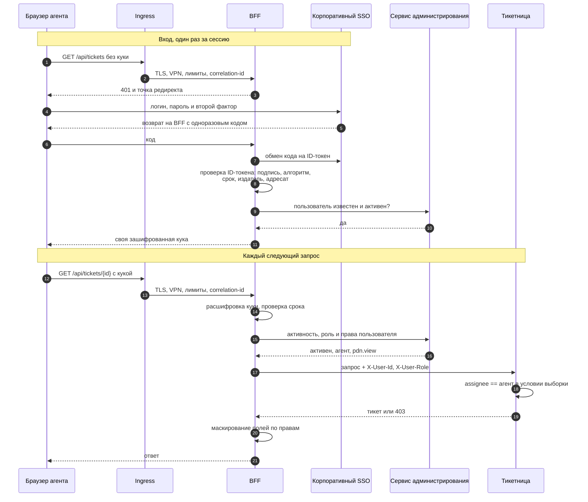

# Аутентификация и авторизация: кто входит и что ему можно

Слой входа уже описан в [entry-layer.md](entry-layer.md) и [ADR-0009](adr/0009-entry-layer-ingress-and-bff.md): BFF владеет сессией, проверяет права и маскирует ПДн. Три вопроса там оставались открытыми: где лежит сессия при двух репликах без sticky sessions, откуда BFF берёт роли и как личность агента доезжает до тикетницы. Документ отвечает на них и раскладывает доступ по ролям, модели и месту проверки.

Пользователи у системы только внутренние: агенты, супервайзоры и администраторы, все за корпоративным VPN и SSO ([clients-and-scenarios.md](clients-and-scenarios.md)). SSO корпоративный, и держит его IT, а не команда тикетницы. На это указывают три места: на [C4](c4-container.md) он внешняя система, на [карте контекстов](bounded-context-map.md) мы к нему Conformist, а в [ADR-0012](adr/0012-inbound-call-for-new-conversations.md) у того же SSO берёт токен сервис другой команды из другого кластера. Поэтому вопрос «кто ты» система отдаёт SSO, а вопрос «что тебе можно» решает сама.

Контекст: [README](../README.md), драйверы: [Utility Tree](utility-tree.md), контейнеры: [C4 Container](c4-container.md). Решения записаны в [ADR-0014](adr/0014-own-session-and-per-request-rights.md), [ADR-0015](adr/0015-ticket-service-trusts-bff-by-network.md) и [ADR-0016](adr/0016-push-routing.md).

## Шаг 1. Кто пользователи и что каждый делает

| Роль | Откуда приходит | Что видит и делает | Чего не должна мочь |
|---|---|---|---|
| Агент | SPA через ingress и BFF, вход через корпоративный SSO | назначенные ему тикеты: карточка, лента, ответ клиенту, заметки, эскалация, возврат в очередь; ПДн и действия над заказом, если выданы права | видеть и трогать тикеты, назначенные другим; видеть ПДн без `pdn.view`; отменять и возвращать заказ без `order.cancel` и `order.refund`; брать тикет себе самому |
| Супервайзор | так же | всю очередь всех линий с агрегатами по команде и SLA, переназначение и эскалацию любого тикета, журнал аудита; ПДн и действия над заказом по правам | управлять пользователями, ролями и правами; видеть ПДн без `pdn.view` |
| Администратор | так же | пользователей, роли и права, правила маршрутизации и SLA-политики, журнал аудита | видеть тикеты и ПДн клиентов; менять роли и права самому себе |
| Сервис обратной связи (ФОС) | `/internal/feedback/*` из внутренней сети компании, токен сервиса | сообщает о новом диалоге, из которого создаётся обращение | читать тикеты; ходить в `/api/*` |
| Корпоративный каталог | `/internal/scim/*` из внутренней сети компании, токен сервиса | заводит и отключает пользователей по SCIM | назначать роли и права; читать что-либо |
| BFF как клиент тикетницы | внутренняя сеть кластера | передаёт запросы агентов вместе с их id и ролью | приходить без личности пользователя |

Три нижние строки не люди. Их проверяют другим механизмом и в другом месте: токеном сервиса и сетевым допуском, а не кукой и ролью.

**Линия поддержки и доступ к ПДн не роли.** Ролей три, остальное ложится поверх них:

- доступ к ПДн, отмена и возврат заказа выдаются правами `pdn.view`, `order.cancel` и `order.refund`. Право одинаково для любого тикета: оно либо есть, либо нет;
- линия поддержки в модель доступа не входит. Тикеты назначает маршрутизатор тикетницы, и агент видит только назначенные ему ([ADR-0016](adr/0016-push-routing.md)). Линия остаётся атрибутом, по которому маршрутизатор выбирает агента, то есть бизнес-логикой.

**Администратор к обращениям не допущен.** Кто раздаёт права, тот сам к данным не ходит: иначе он выдал бы себе `pdn.view`, а аудит отметил бы это задним числом. Если человек и администратор, и супервайзор, у него две роли.

## Шаг 2. Как устроен вход

Пароли система не проверяет: вход целиком у корпоративного SSO по OIDC. После входа SSO не нужен, BFF держит сессию сам.

Что где происходит:

- **SSO** единственное место с паролями и вторым фактором. Система обращается к нему только при входе.
- **BFF при входе** обменивает одноразовый код на ID-токен и проверяет его: подпись ключом SSO, алгоритм по своему списку разрешённых, срок, издателя и адресата. Пользователь, которого нет в сервисе администрирования или который неактивен, куку не получает. Токены SSO нигде не хранятся.
- **BFF на каждом запросе** расшифровывает свою куку, проверяет её срок и спрашивает сервис администрирования про пользователя. Это и есть точка проверки: подпись токена SSO проверяется один раз при входе, дальше личность держится на нашей куке, а актуальность на ответе сервиса администрирования.
- **Тикетница** куку не видит. Она получает id агента и роль заголовками от BFF и по ним проверяет назначение тикета.

**Кука.** `HttpOnly`, `Secure`, `SameSite=Lax`, без `Domain`: скрипт на странице её не прочтёт, на другие хосты она не уедет, а `SameSite` закрывает CSRF. Внутри id пользователя и сроки, всё зашифровано ключом BFF. Ключ общий у реплик, поэтому любая реплика расшифрует куку сама, и BFF остаётся stateless. Срок: час без запросов или 12 часов с момента входа, что наступит раньше. 12 часов это одна смена.

**Почему без токенов SSO.** Обычная пара access на минуты и refresh на часы здесь лишняя: BFF и так ходит в сервис администрирования на каждом запросе, и тот же ответ говорит, активен ли пользователь. Токены добавили бы зависимость от SSO на каждое обновление, гонку трёх параллельных опросов ([ADR-0006](adr/0006-polling-over-push.md)) за одноразовый refresh и упор в лимит куки в 4 КБ, ничего не дав взамен. Варианты с Redis, sticky sessions и токенами разобраны в [ADR-0014](adr/0014-own-session-and-per-request-rights.md).

**Права на каждом запросе и отказ.** Снятое право, например `pdn.view`, перестаёт действовать со следующего запроса. Плата: сервис администрирования обязателен на каждом запросе. Если он не ответил, BFF отвечает 503 и права не угадывает. Права, в отличие от источников контекста, основание страницы: без них неизвестно, что можно показать, и любая угадка даёт либо лишний доступ, либо неверно урезанный. Так же устроена и тикетница в [S6](utility-tree.md): без неё карточке нечего показать. Отсюда требование к сервису администрирования: доступность 99.95%, иначе вся цепочка не удержит 99.9% из S5.

**Увольнение.** Корпоративный каталог сам сообщает о заведённых и отключённых пользователях по SCIM. Путь устроен как у сервиса обратной связи в [ADR-0012](adr/0012-inbound-call-for-new-conversations.md): ingress пускает `/internal/scim/*` только из внутренней сети компании, BFF проверяет токен сервиса от того же SSO и передаёт вызов в сервис администрирования. Отключённый пользователь получает 401 на следующем запросе, кука сбрасывается. На случай потерянного сообщения раз в сутки идёт полная сверка с каталогом. Худший случай: потерялось и сообщение, и до сверки далеко. Тогда агент работает до конца сессии, не дольше 12 часов, а войти заново не сможет, потому что SSO его уже не пустит.

**Межсервисный вход.**

- **ФОС и корпоративный каталог** приходят из-за пределов кластера с токеном сервиса, BFF проверяет его локально по опубликованным ключам SSO. `/internal/*` не принимает пользовательскую куку, `/api/*` не принимает токен сервиса.
- **BFF → тикетница** идёт внутри кластера. Тикетница принимает соединения только от подов BFF (NetworkPolicy) и верит заголовкам с id агента и ролью. BFF всегда ставит эти заголовки сам и никогда не пересылает пришедшие от клиента. Принятый риск: кто может задеплоить в namespace под с меткой BFF, тот может им притвориться. Варианты с токеном и mTLS разобраны в [ADR-0015](adr/0015-ticket-service-trusts-bff-by-network.md).
- **Тикетница → сервис администрирования** за линией агента для маршрутизации и **сервис администрирования → аудит** с изменениями прав идут внутри кластера по тому же принципу сетевого допуска.

## Шаг 3. Какая модель авторизации

**RBAC как основа и ABAC поверх него на два правила.**

Роли и права закрывают почти всё: ролей три, прав несколько, меняются они редко и читаются в аудите глазами. Но одно правило ролью не выражается: агент видит только назначенные ему тикеты. Иванов и Петров оба агенты с одинаковыми правами, тикет 123 назначен Иванову, тикет 124 Петрову. Роль у них одна, а набор тикетов у каждого свой, и роль на каждого агента не заведёшь. Решение здесь сравнивает атрибут тикета с атрибутом агента: `ticket.assignee == agent.id`. Это ABAC. Второе правило той же природы: администратор не меняет права самому себе, `subject.id != target.id`.

Полный ABAC не нужен. «Супервайзор видит всё» и «ПДн видны с `pdn.view`» прекрасно выражаются ролью и правом, а перевод их в атрибуты стоил бы читаемости там, где она бесплатна.

**MAC не нужен.** Он нужен, когда метки на данных и допуски людей задаёт кто-то снаружи и обойти их нельзя, как с гостайной. ПДн у системы под 152-ФЗ, но закон меток не ставит. Он требует хранить данные в РФ ([S9](utility-tree.md)), ограничить доступ теми, кому он нужен для работы, и вести учёт (ст. 19). Кому давать доступ, решает оператор, а ролевой метод разграничения прямо разрешён приказом ФСТЭК №21. Ограничение доступа закрыто правом `pdn.view`, учёт закрыт аудитом [S10](utility-tree.md).

**Где считается.** Отдельного policy-сервиса нет. Сервис администрирования хранит роли и права, но решений не принимает: решает тот, кто знает объект. Правила по роли считает BFF, назначение тикета считает тикетница (только она знает `assignee`), правило «не себе» считает сервис администрирования.

| Правило | Модель | Где считается |
|---|---|---|
| Пускать к очереди целиком, журналу, экранам администрирования | RBAC, роль | BFF |
| Видеть ПДн | RBAC, право `pdn.view` | BFF, маскирование полей |
| Отменять и возвращать заказ | RBAC, права `order.cancel` и `order.refund` | BFF |
| Видеть и трогать только назначенные тикеты | ABAC: `ticket.assignee == agent.id` | тикетница, в условии выборки |
| Не менять права самому себе | ABAC: `subject.id != target.id` | сервис администрирования |

## Шаг 4. Где проверяется принадлежность

Каждая операция над тикетом проверяет две вещи: право у роли и то, что тикет назначен этому агенту. Для супервайзора вторая проверка заменяется ролью. Без неё получается самая частая дыра из урока: роль проверили, а владельца забыли. Агент с правом `order.refund` вернул бы деньги по чужому тикету, отправив запрос руками из консоли браузера.

| Операция | Что проверяется | Место проверки |
|---|---|---|
| `GET /api/tickets`, очередь | агенту только назначенные, супервайзору все | тикетница, в условии запроса к БД |
| `GET /api/tickets/{id}`, карточка | тикет назначен агенту или пришёл супервайзор | тикетница; BFF не отдаёт ответ до её подтверждения |
| Заметка, смена статуса, эскалация, переназначение, возврат в очередь | право роли и назначение | тикетница |
| Ответ клиенту, вложение | назначение; id треда берётся из ответа тикетницы | тикетница, затем BFF идёт в ФОС |
| Отмена и возврат заказа | право `order.cancel` или `order.refund` и назначение; номер заказа берётся из тикета | BFF и тикетница, затем BFF идёт в заказы |
| Журнал аудита | роль супервайзора или администратора | BFF |
| Изменение ролей и прав | роль администратора и цель не он сам | сервис администрирования |

Четыре правила, на которых легко обжечься:

- **Условие, а не фильтр.** Назначение входит в условие запроса к БД тикетницы. Фильтр по уже полученному списку тоже работает, но только до того дня, когда его забудут в новой ручке.
- **Тикетница не прокси для чужих сервисов.** Ответ клиенту, вложение, отмена и возврат заказа идут из BFF прямо в ФОС и заказы (стыки 9-11 в [interaction-model.md](interaction-model.md)). Перед этим BFF спрашивает тикетницу «дай тикет для этого агента» и берёт номер заказа и id треда из её ответа, а не из запроса. Иначе агент подставит заказ, не связанный с его тикетом. Ручек, которые по факту отвечают за другие сервисы, в тикетнице нет: смена протокола ФОС или заказов ядро не трогает.
- **Карточка собирается только после ответа тикетницы.** По [ADR-0010](adr/0010-single-endpoint-per-card.md) BFF ходит в тикетницу, кеш и ФОС параллельно. Если тикетница ответила, что тикет чужой, всё полученное параллельно выбрасывается, а просмотр ПДн в аудит не пишется. Времени это не стоит: ответ и так ждёт самого медленного источника.
- **Чужой тикет получает 403, а не 404.** Урок по умолчанию советует 404, чтобы не подтверждать существование объекта. Здесь сам факт существования не секрет: номера идут подряд, тикетов тысячи, и каждый агент это знает. 403 понятнее агенту, которому коллега скинул ссылку, и служит сигналом: каждый отказ пишется в аудит, а серия отказов от одного агента означает перебор номеров. В теле ответа о тикете ничего нет.

## Что осталось за границей задания

- **Выход из системы.** Урок требует вместе с нашей кукой сбрасывать и сессию у SSO, иначе следующий вход пройдёт молча. Сценарий выхода отдельно не прорабатывался.
- **Ключ шифрования куки.** Где он хранится и как ротируется, разбирается вместе с остальными секретами в задании про Kubernetes.
- **Доступность сервиса администрирования.** 99.95% записано как требование. Как её удержать и как она ложится в бюджет ошибок, разбирается в задании про отказоустойчивость.
- **Алерт на серию 403.** Сигнал назван, порог и реакция дежурного появятся в задании про мониторинг.
- **Присутствие и загрузка агентов.** Push-маршрутизации нужно знать, кто из агентов на месте и насколько загружен. В доках этого пока нет ([ADR-0016](adr/0016-push-routing.md)).

## Находки в ранее принятых решениях

**Сервис администрирования потерялся по дороге к C4.** В [декомпозиции](service-decomposition.md) и на [карте контекстов](bounded-context-map.md) администрирование отдельный контекст: пользователи, роли и права, и BFF берёт у него «роли и права». На [C4 Container](c4-container.md) такого контейнера не было, и откуда BFF знает роли, не говорилось нигде. Контейнер и его база возвращены на диаграмму вместе со стрелками.

**BFF «владел сессией» и при этом был stateless.** [entry-layer.md](entry-layer.md) записывал оба утверждения рядом и не говорил, где лежит сессия при двух репликах без sticky sessions. Теперь она лежит в зашифрованной куке ([ADR-0014](adr/0014-own-session-and-per-request-rights.md)).

**Личность агента не доезжала до тикетницы.** В [clients-and-scenarios.md](clients-and-scenarios.md) записано, что агент видит назначенные ему тикеты, но как тикетница узнаёт агента, не описывалось ([ADR-0015](adr/0015-ticket-service-trusts-bff-by-network.md)).

**Действия мимо тикетницы не проверяли назначение.** Стыки 9-11 идут из BFF прямо в ФОС и заказы, а назначение знает только тикетница. Заодно C4 приписывал запись действий над заказом в аудит тикетнице, которой в этом пути нет. Порядок проверки описан в шаге 4, стрелка аудита на C4 перенесена на BFF.

**S2 предполагал, что агент выбирает тикет сам.** Фраза «без этого агент не видит, какой тикет критичнее» имеет смысл, только если агент разбирает общую очередь. При push-маршрутизации сортировка нужна маршрутизатору. Формулировка в [utility-tree.md](utility-tree.md) переписана ([ADR-0016](adr/0016-push-routing.md)).

**SSO стоял на пути каждого запроса.** В [interaction-model.md](interaction-model.md) стык 5 «BFF → SSO, проверка сессии» шёл на каждом пользовательском запросе. Теперь SSO нужен только при входе, а на каждом запросе BFF ходит в сервис администрирования. Таблицы стыков дополнены.

**Права в интерфейсе живут до перезагрузки вкладки.** По [ADR-0004](adr/0004-permissions-in-shared.md) и [cache-points.md](cache-points.md) интерфейс запрашивает права один раз. Снятое право на бэкенде действует сразу, а кнопка в интерфейсе останется до перезагрузки, и нажатие получит 403. Это принимается: интерфейс механизмом защиты не является, источник истины BFF.
