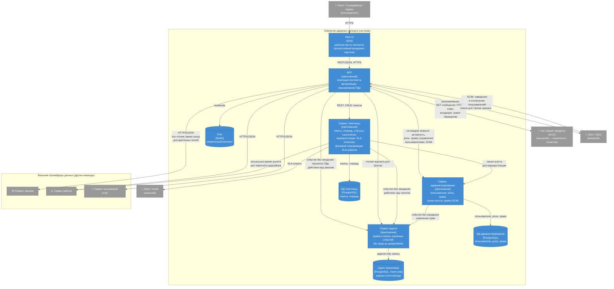

# C4 — Container (C2)

Первый зум внутрь системы: из каких частей она собрана. Контейнер в C4 — это то, что **разворачивается отдельно**: приложение, база данных, кэш. Не модуль и не класс, а самостоятельная единица развёртывания. По этому критерию у системы пять приложений-контейнеров и четыре хранилища.

Контекстная диаграмма — см. [C4 Context](c4-context.md), драйверы — [Utility Tree](utility-tree.md), компромиссы — [Trade-offs](tradeoffs.md).

## Диаграмма

**Режим связей.** Все связи синхронные, кроме трёх, подписанных «без ожидания»: запись в аудит идёт без гарантии доставки, потому что сценарий аудита допускает редкую потерю записи ([S10](utility-tree.md)), и на пути запроса не стоит. Таймауты, пулы и предохранители на диаграмму не вынесены, чтобы она читалась: разметка по каждому стыку в [interaction-model.md](interaction-model.md), условие работоспособности BFF в [entry-layer.md](entry-layer.md#условие-работоспособности-решения-один-bff).

## Контейнеры и откуда какие требования

**Web UI (SPA)** — рабочее место агента, супервайзора и админа. Разворачивается отдельно: статические ассеты в образе nginx со своим Deployment ([ADR-0017](adr/0017-spa-static-in-nginx-image.md)). В браузере не ходит во внешние сервисы напрямую, только в BFF. Прогрессивный рендеринг карточки — из компромисса [TO-1](tradeoffs.md) (S3, S6).

**BFF** — единая точка входа для UI. Собирает контекст тикета из внешних продуктовых сервисов и приводит его к единой модели (S15), проверяет права и **маскирует ПДн до отдачи в UI** (S8), проксирует операции над тикетами в ядро. Сессию держит сам, в зашифрованной куке, а активность пользователя и его права на каждом запросе берёт у сервиса администрирования ([ADR-0014](adr/0014-own-session-and-per-request-rights.md)). Некритичный контекст берёт из кэша, критичные к времени поля (статус/время рейса) — всегда live (S3, TO-1). Также **проксирует переписку с клиентом** к чат-сервису продукта (ФОС): показывает агенту входящие сообщения и отправляет его ответы. В отличие от read-only источников данных, это двусторонняя интеграция (чтение + отправка); сообщениями клиента система не владеет — они живут в ФОС. Лента же обращения собирается системой: в неё кроме сообщений из ФОС входят внутренние заметки агента и системные события — и те, и другие хранятся в тикетнице.

**Сервис тикетницы** — доменное ядро: тикеты, очередь, статусы, назначения, маршрутизация, SLA-политика (S2, S4, S5). Внутри него живёт **фоновый планировщик**: периодически сканирует дедлайны, шлёт оповещения в Slack/email (S1) и тем же проходом пересчитывает `deadline_at` по актуальному времени вылета (S2). Ради этого тикетница обращается к сервису рейсов напрямую, а не через BFF: это фоновый процесс, а не пользовательский запрос, и слой входа был бы здесь лишним хопом. Адаптер рейсов живёт внутри тикетницы, поэтому ACL соблюдён (S14): доменное ядро получает данные для вычисления своего поля, а не хранит чужое. Отдельным контейнером планировщик не выделен — см. ниже.

**Сервис аудита** — принимает события от BFF (просмотры ПДн и действия над заказами), от ядра (действия над тикетами) и от сервиса администрирования (изменения прав) и пишет их в неизменяемое хранилище. Он же отдаёт журнал на чтение: экран `/journal` доступен супервайзору и администратору, выборка идёт через BFF с фильтрами по пользователю, тикету и периоду. Запись и чтение — разные профили (fire-and-forget против редких тяжёлых выборок), но владелец журнала один: прямого доступа к аудит-хранилищу мимо сервиса нет. Вынесен отдельно по трём причинам: у него **три писателя** (BFF, ядро и сервис администрирования) — логику незачем дублировать; **изоляция ради неизменяемости** — основной код не имеет прав на update/delete журнала; **другой профиль нагрузки** — поток fire-and-forget записей не должен влиять на latency агента (S10).

**Сервис администрирования** хранит пользователей, роли, права и линию агента. Это возможность 8 из [декомпозиции](service-decomposition.md), которая на этой диаграмме раньше отсутствовала. BFF ходит в него на каждом запросе за активностью, ролью и правами пользователя, тикетница берёт у него линию агента для маршрутизации ([ADR-0016](adr/0016-push-routing.md)), а заведение и отключение пользователей приходит из корпоративного каталога по SCIM через ingress и BFF. Без ответа сервиса BFF запрос не обрабатывает, поэтому от него требуется доступность 99.95% ([auth-model.md](auth-model.md)).

**Хранилища.** БД тикетницы (тикеты, очередь), аудит-хранилище (append-only журнал), кэш Redis (некритичный контекст) и БД администрирования (пользователи, роли, права): четыре отдельных контейнера данных. Три базы PostgreSQL эксплуатирует платформенная команда компании, в кластере их нет, а Redis живёт в кластере без диска ([kubernetes-objects.md](kubernetes-objects.md#шаг-1-что-станет-deployment-а-что-service)).

## Что не нарисовано и почему

- **Планировщик SLA-алертов** — это компонент внутри сервиса тикетницы, а не отдельный контейнер. Он не требует независимого масштабирования (одна проверка раз в минуту), не имеет отдельного жизненного цикла и полностью зависит от данных тикетницы. Отдельный деплой ничего не даёт, а сложность добавляет. Всплывёт на уровне C3 (Component).
- **Адаптеры внешних источников** (anti-corruption layer из S14) — компоненты внутри BFF, разворачиваются вместе с ним. На уровне контейнеров показывать их было бы нарушением определения «контейнер = отдельная единица развёртывания».
- **Проверка ролей и маскирование** — тоже компоненты BFF, не самостоятельные контейнеры.

Внутренности BFF и тикетницы — предмет следующего уровня C4 (**Component**). В этом задании он не требуется.
