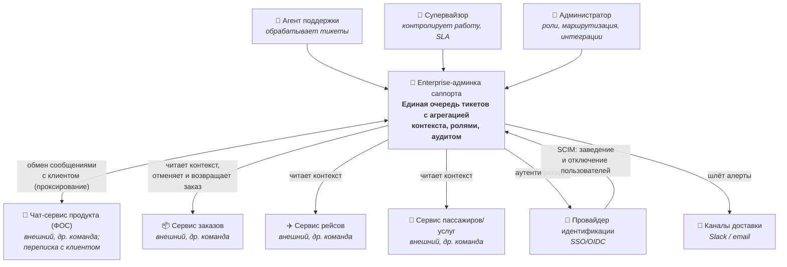

# C4 — Context (C1)

Система как единое целое, её пользователи и внешнее окружение. Контекст системы — см. [README](../README.md), драйверы — [Utility Tree](utility-tree.md), компромиссы — [Trade-offs](tradeoffs.md), контейнеры — [C4 Container](c4-container.md).

**Границы системы.** Внутри — рабочее место саппорта и всё, что управляет тикетами. Снаружи — продуктовые сервисы других команд:

- **Заказы, рейсы, пассажиры** — система читает из них контекст, не владея данными. Исключение одно: отмена и возврат заказа выполняются в сервисе заказов, туда система пишет (стык 11 в [interaction-model.md](interaction-model.md)).
- **Провайдер идентификации** не только проверяет вход. Корпоративный каталог за ним сам сообщает системе о заведённых и отключённых пользователях по SCIM, так решено вместе со своей сессией BFF ([ADR-0014](adr/0014-own-session-and-per-request-rights.md)).
- **Чат-сервис продукта (ФОС)** — канал общения с клиентом. Сообщения клиента хранит и транспортирует ФОС; внутренние заметки и системные события ленты принадлежат системе; система её **проксирует** (двусторонне: показывает входящие клиента, отправляет ответы агента), но самим тредом не владеет.
