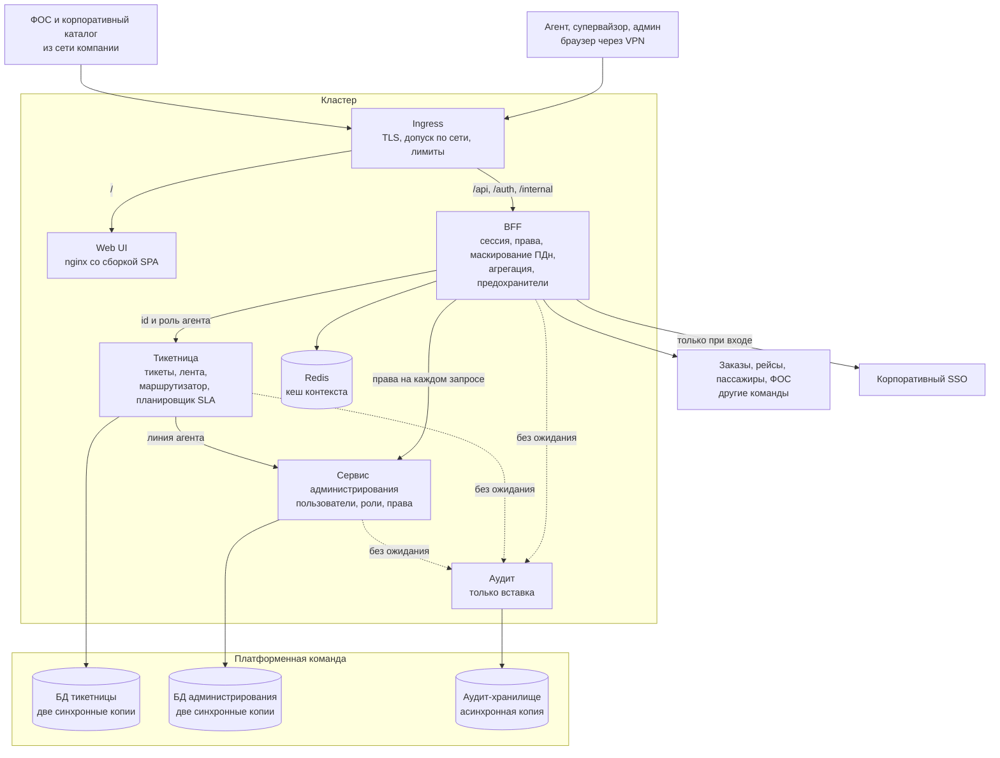

# Итоговое архитектурное решение: админка саппорта целиком

Вторая половина итогового проекта. Новых решений здесь нет, кроме решения по данным из первой половины ([data-scaling.md](data-scaling.md)). Задача документа другая: показать, что решения, принятые в разных заданиях, складываются в одну систему, и что каждое из них держит какой-то драйвер темы. Решение без драйвера это повод его перечитать: либо драйвер забыт, либо решение лишнее.

## Тема и драйверы

Тема одной фразой: **агент саппорта авиабилетов ведёт обращение от первого сообщения до закрытия и видит весь контекст в одном интерфейсе, а в «ковры» на 10 000+ тикетов от скорости его ответа зависит, успеет ли клиент на рейс.** Подробно в [README](../README.md).

Драйверы выведены из этой фразы в [разборе архитектуры](architecture-review.md#шаг-1-драйверы-прямо-из-формулировки-темы), у каждого есть мера в [дереве полезности](utility-tree.md):

| Драйвер | Мера |
|---|---|
| **Агрегация контекста** | ядро карточки за 2 с на p95, единая модель для разнородных источников |
| **Работа в пик** | 500 агентов и 10 000+ тикетов, доступность 99.9% в месяц, в «ковры» без деградации |
| **Срочность по вылету** | тикет со сдвинувшимся рейсом первый в очереди за 1 мин, алерт о дедлайне за 2 мин, 0 пропущенных |
| **Своевременность событий** | агент узнаёт о событии по своему тикету за 30 с |
| **Разграничение доступа к ПДн** | 100% полей с ПДн замаскированы для ролей без права, ПДн только в РФ |
| **Аудит** | неизменяемый журнал просмотров ПДн и действий над заказом |
| **Изоляция внешних источников** | отказ источника не роняет карточку, новый источник без правок ядра |

Главными из них выбраны агрегация контекста, работа в пик и срочность по вылету.

**Главный размен проекта:** бережём актуальность всего, что влияет на клиента и на доступ, платим обязательными зависимостями на пути запроса. Разбор и условия пересмотра в [Trade-offs](tradeoffs.md#главный-размен-проекта).

## Декомпозиция: из чего система и где границы

| Решение | Документ | Какой драйвер держит |
|---|---|---|
| Тикетница ведёт обращение, маршрутизацию и SLA; администрирование и аудит отдельными сервисами | [декомпозиция](service-decomposition.md), [карта контекстов](bounded-context-map.md), [доска событий](event-storming.md) | срочность по вылету: SLA и приоритизация в ядре; разграничение доступа и аудит меняются по своим причинам |
| Аудит отдельным сервисом, у которого нет прав на изменение журнала | [C4 Container](c4-container.md) | аудит |
| Источники других команд за адаптерами внутри BFF | [декомпозиция](service-decomposition.md) | изоляция внешних источников |
| Планировщик SLA и маршрутизатор живут внутри тикетницы | [решение о планировщике SLA](adr/0002-sla-scheduler-in-ticket-service.md), [решение о push-маршрутизации](adr/0016-push-routing.md) | срочность по вылету |
| Фронтенд по FSD, один репозиторий без микрофронтендов, права в `shared` | [фронтенд-архитектура](frontend-architecture.md), [фичи внутри виджетов](adr/0003-features-inside-widgets.md), [права в shared](adr/0004-permissions-in-shared.md), [один репозиторий](adr/0007-single-repo-no-microfrontends.md) | драйвера темы нет: решение держит размер команды в 3-6 человек |

Последняя строка единственная без драйвера темы, и это честно: структуру фронтенда определяет команда, а не предметная область.

## Взаимодействие и доступ: кто кого вызывает и кто что видит

| Решение | Документ | Какой драйвер держит |
|---|---|---|
| Вход через ingress и один BFF | [клиенты и сценарии](clients-and-scenarios.md), [слой входа](entry-layer.md), [решение о слое входа](adr/0009-entry-layer-ingress-and-bff.md) | агрегация контекста; разграничение доступа: ПДн маскируются в BFF |
| Одна ручка на карточку, источники опрашиваются параллельно | [решение об одной ручке](adr/0010-single-endpoint-per-card.md) | агрегация контекста |
| Опрос вместо push-канала | [решение об опросе](adr/0006-polling-over-push.md) | своевременность событий; работа в пик: BFF без состояния |
| Новое обращение создаётся встречным вызовом ФОС с дедупликацией по диалогу | [модели взаимодействия](interaction-model.md), [решение о встречном вызове](adr/0012-inbound-call-for-new-conversations.md) | срочность по вылету: обращение появляется сразу |
| Брокера нет, все стыки синхронные, кроме записи в аудит | [модели взаимодействия](interaction-model.md), [решение без брокера](adr/0013-no-message-broker.md) | аудит: его записи и так без гарантии доставки |
| Своя сессия BFF, права на каждом запросе, увольнение по SCIM | [модель доступа](auth-model.md), [решение о сессии](adr/0014-own-session-and-per-request-rights.md) | разграничение доступа к ПДн |
| Роли и права плюс проверка назначения тикета в тикетнице, в которую пускают только BFF | [модель доступа](auth-model.md), [решение о доверии тикетницы](adr/0015-ticket-service-trusts-bff-by-network.md) | разграничение доступа к ПДн |
| Тикеты назначает маршрутизатор, агент видит только назначенные | [решение о push-маршрутизации](adr/0016-push-routing.md) | срочность по вылету |

## Надёжность и наблюдаемость

| Решение | Документ | Какой драйвер держит |
|---|---|---|
| Рендеринг в браузере, статика в образе nginx, откат через Deployment, выкатка заморожена в «ковры» | [рендеринг в браузере](adr/0005-csr-over-ssr.md), [деплой и откат](adr/0008-atomic-deploy-and-rollback.md), [статика SPA](adr/0017-spa-static-in-nginx-image.md) | работа в пик |
| Шесть Deployment, по две реплики у приложений, базы у платформенной команды | [объекты кластера](kubernetes-objects.md) | работа в пик |
| Таймауты, предохранители и один повтор по каждому источнику | [тактики отказоустойчивости](resilience-tactics.md#шаг-1-типы-сбоев-и-тактика-под-каждый), [слой входа](entry-layer.md#условие-работоспособности-решения-один-bff) | изоляция внешних источников |
| При отказе блокируются действия, а не экран | [дерево полезности](utility-tree.md), [тактики отказоустойчивости](resilience-tactics.md#шаг-2-синхронная-поверхность-по-классам) | изоляция внешних источников |
| Бюджет времени карточки разложен по вызовам, запас 45 мс | [тактики отказоустойчивости](resilience-tactics.md#шаг-3-бюджет-времени) | агрегация контекста |
| Метрики с двух сторон, алерты на скорость траты бюджета ошибок, три дашборда | [план наблюдаемости](observability-plan.md) | работа в пик; срочность по вылету: алерт на зависший проход планировщика |

## Данные и кеш

| Решение | Документ | Какой драйвер держит |
|---|---|---|
| Кеш по типу данных, время рейса только вживую | [кеширование по типу данных](adr/0001-caching-per-data-type.md), [Trade-offs](tradeoffs.md) | агрегация контекста и срочность по вылету |
| Тикет владеет своим дедлайном, а не копией времени вылета | [дерево полезности](utility-tree.md) | срочность по вылету |
| На клиенте кешируются только неизменяемые ассеты, вложения не кешируются | [точки кеширования](cache-points.md), [инвалидация](cache-invalidation.md), [вложения](adr/0011-attachments-not-cached-on-client.md) | разграничение доступа к ПДн: ничего не оседает на диске ноутбука |
| Одна база на сервис без реплик чтения и шардов, тикеты хранятся 3 года | [решение по данным](data-scaling.md), [ADR-0018](adr/0018-single-database-per-service.md) | работа в пик: запас в 10-20 раз |
| Ключи дедупликации новых обращений в отдельной таблице без секций | [решение по данным](data-scaling.md#шаг-2-масштабирование-лестница-снизу-вверх), [решение о встречном вызове](adr/0012-inbound-call-for-new-conversations.md) | срочность по вылету: повтор от ФОС не создаёт второй тикет даже на стыке месяцев |
| Две синхронные резервные копии у тикетов и прав, подтверждение от любой; при отказе обеих асинхронный режим с алертом | [решение по данным](data-scaling.md#шаг-3-репликация), [ADR-0018](adr/0018-single-database-per-service.md) | срочность по вылету: обращение не теряется; разграничение доступа: снятое право не возвращается |

## Система одной схемой

Подробные диаграммы: [C4 Context](c4-context.md), [C4 Container](c4-container.md), [слой входа](views/entry-layer.md), [взаимодействия](views/interaction-map.md), [кеш](views/cache-map.md).

## Что осталось открытым

У каждого открытого вопроса есть условие, при котором к нему возвращаемся.

1. **Реплика чтения.** Появляется, если в «ковёр» p95 ответа тикетницы агентам выше 200 мс, пока супервайзоры смотрят очередь ([ADR-0018](adr/0018-single-database-per-service.md)).
2. **Шарды.** Возвращаются, если база тикетницы больше 500 ГБ или запись в пик устойчиво выше 1 000 в секунду.
3. **Как отмечать присутствие агента:** на каждом опросе или кнопкой «на смене». Решается до реализации маршрутизатора: на каждом опросе это 33 записи в секунду, больше половины всей записи в пик.
4. **Срок хранения аудита в 2 месяца.** Сам сценарий аудита помечен как требующий согласования с юристами. Если они потребуют дольше, пересчитывается объём аудит-хранилища, механизм секций не меняется.
5. **Числа по измерениям:** таймауты записи, пороги предохранителей, ресурсы и автомасштабирование, точный таймаут сервиса администрирования по 99-му перцентилю. Показатели для всех названы в [плане наблюдаемости](observability-plan.md), значения ставятся под нагрузкой.
6. **Второй ЦОД.** Не рассматривался: драйверы его не требуют. Появится требование пережить потерю площадки, и начинать надо будет с согласованности, а не с репликации.

## В каком порядке читать

1. [README](../README.md): тема, пользователи, характеристики.
2. [Дерево полезности](utility-tree.md) и [Trade-offs](tradeoffs.md): что важно и чем ради чего жертвуем.
3. [Доска событий](event-storming.md), [карта контекстов](bounded-context-map.md), [декомпозиция](service-decomposition.md): границы.
4. [C4 Context](c4-context.md) и [C4 Container](c4-container.md): система снаружи и изнутри.
5. [Клиенты и сценарии](clients-and-scenarios.md), [слой входа](entry-layer.md), [модели взаимодействия](interaction-model.md), [модель доступа](auth-model.md): кто кого вызывает и кто что видит.
6. [Точки кеширования](cache-points.md), [инвалидация](cache-invalidation.md), [решение по данным](data-scaling.md): данные.
7. [Объекты кластера](kubernetes-objects.md), [тактики отказоустойчивости](resilience-tactics.md), [план наблюдаемости](observability-plan.md): эксплуатация.
8. [Разбор архитектуры](architecture-review.md): проверка всего написанного одним методом.
9. [Фронтенд-архитектура](frontend-architecture.md): отдельно, для тех, кто будет писать клиент.
