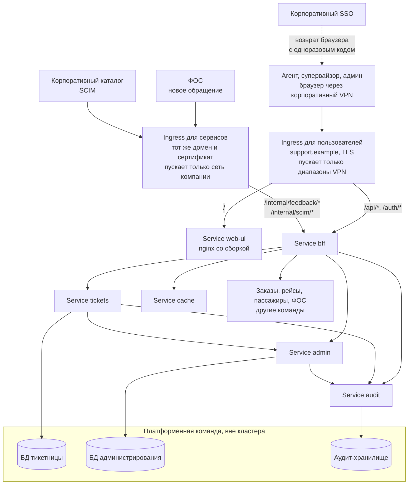

# Система в кластере: базовые объекты и что мешает быть stateless

Занятие обзорное, поэтому манифестов здесь нет. Задача другая: разложить систему на объекты Kubernetes и посмотреть, что из уже принятых решений при этом не ложится. Не легли четыре вещи: статику SPA в доках «раздавал ingress», который файлов не отдаёт; у возврата от SSO после входа не было пути; маршрутизатор при двух репликах назначал бы тикеты дважды; а ключи дедупликации новых обращений из [ADR-0012](adr/0012-inbound-call-for-new-conversations.md) не имели места, и по умолчанию оказались бы в памяти процесса.

Контекст: [README](../README.md), контейнеры: [C4 Container](c4-container.md), слой входа: [entry-layer.md](entry-layer.md), доступ: [auth-model.md](auth-model.md). Новое решение записано в [ADR-0017](adr/0017-spa-static-in-nginx-image.md).

## Шаг 1. Что станет Deployment, а что Service

Правило из урока: **Service заводится тому, к кому кто-то обращается по сети.** У этой системы к каждому приложению кто-то ходит, поэтому Service есть у всех.

| Часть | Deployment | Service | Реплик | Кто обращается |
|---|---|---|---|---|
| Web UI: nginx со сборкой SPA | `web-ui` | `web-ui` | 2 | ingress, путь `/` |
| BFF | `bff` | `bff` | 2 | ingress, `/api/*`, `/auth/*`, `/internal/*` |
| Тикетница: API, планировщик SLA, маршрутизатор | `tickets` | `tickets` | 2 | только BFF ([ADR-0015](adr/0015-ticket-service-trusts-bff-by-network.md)) |
| Аудит | `audit` | `audit` | 2 | BFF, тикетница, администрирование |
| Администрирование | `admin` | `admin` | 2 | BFF, тикетница |
| Кеш Redis | `cache` | `cache` | 1 | BFF |
| БД тикетницы, администрирования, аудита | нет | нет | | у платформенной команды, вне кластера |

Две реплики у приложений нужны не для пропускной способности: при одной каждая выкатка и каждый вывод узла на обслуживание расходуют бюджет [S5](utility-tree.md), а rolling update на одной реплике невозможен ([entry-layer.md](entry-layer.md#один-bff-и-количество-реплик)).

**Тикетница остаётся одним Deployment.** Повод разделить API и фоновую работу был бы, если бы их нагрузка росла по-разному. Здесь фоновая работа маленькая: планировщик просыпается раз в минуту, а в «ковёр» делает один батч-запрос на несколько десятков рейсов. Брокера, из которого пачками приходят события, нет ([ADR-0013](adr/0013-no-message-broker.md)). Отдельного масштабирования и жизненного цикла планировщику не нужно, это записано ещё в [ADR-0002](adr/0002-sla-scheduler-in-ticket-service.md).

Одно следствие пришло вместе с push-маршрутизацией ([ADR-0016](adr/0016-push-routing.md)): реплик две, значит, и маршрутизаторов два, и оба назначили бы один свободный тикет или перегрузили бы одного агента. Маршрутизатор берёт ту же консультативную блокировку в базе, что и планировщик, и в каждый момент назначает одна реплика. Один поток назначения не узкое место: назначать можно, только когда у агента освободилось место, а агентов 500. Цена та же, что у планировщика: зависший держатель блокировки останавливает назначение, поэтому проход, который давно не завершался, поднимает алерт.

**Web UI это обычный сервис.** Ingress файлов не отдаёт, он только направляет запрос по домену и пути. Сборка SPA едет в образе nginx, каждый релиз это новый образ в registry, откат идёт через Deployment. Старые сборки после релиза не хранятся, и открытая вкладка получает предложение обновиться. Это меняет часть [ADR-0008](adr/0008-atomic-deploy-and-rollback.md), разбор вариантов в [ADR-0017](adr/0017-spa-static-in-nginx-image.md).

**Redis в одном экземпляре и без диска.** Это кеш некритичного контекста ([ADR-0001](adr/0001-caching-per-data-type.md)): при потере он прогревается сам. Две независимые реплики без репликации делили бы ключи случайно, запись в одну и чтение из другой давали бы промах, поэтому вторая не нужна.

**Базы у платформенной команды компании.** Держать PostgreSQL с переключением при отказе и бэкапами отдельная работа, а команда продукта маленькая, 3-6 человек ([ADR-0008](adr/0008-atomic-deploy-and-rollback.md)). В кластере живёт то, что приходит и уходит, постоянное вынесено за его пределы. Отсюда требования к смежникам:

- база администрирования: 99.95% с переключением при отказе, иначе не держится [ADR-0014](adr/0014-own-session-and-per-request-rights.md);
- все три базы: восстановление не дольше 15 минут по [сценарию восстановления](utility-tree.md) (S7), размещение в ЦОД в РФ по [S9](utility-tree.md). Допустимая потеря данных нулевая у тикетницы и администрирования (синхронная резервная копия) и секунды у аудита, уточнено в [решении по данным](data-scaling.md#шаг-3-репликация);
- аудит-хранилище: у пользователя приложения нет прав на UPDATE и DELETE, диск рассчитан на 2 месяца журнала ([S10](utility-tree.md)).

## Шаг 2. Как устроен вход снаружи

Домен один, сертификат один, TLS терминируется на входе. NodePort и LoadBalancer отдельным сервисам не заводятся: они дали бы столько внешних адресов и сертификатов, сколько сервисов.

| Путь | Куда | Откуда пускаем |
|---|---|---|
| `/` | Service `web-ui` | корпоративный VPN |
| `/api/*` | Service `bff` | корпоративный VPN |
| `/auth/*` | Service `bff` | корпоративный VPN |
| `/internal/feedback/*`, `/internal/scim/*` | Service `bff` | внутренняя сеть компании |

**Объектов Ingress два на одном домене.** Допуск по сети задаётся на весь объект, а пускать пользователей и сервисы надо из разных сетей. Поэтому первый объект держит пути для браузера с диапазонами VPN, второй держит `/internal/*` с диапазонами сети компании.

**Возврат от SSO получил свой путь `/auth/*`.** После входа SSO отправляет браузер обратно к BFF с одноразовым кодом. Это переход всей страницы, а не запрос SPA, и среди правил его не было: попади он под `/`, код ушёл бы в nginx фронтенда, и вход не работал бы. Под `/auth/*` лежат вход, возврат от SSO и выход, туда можно без сессии, и ответы там редиректы. Отдельный префикс выбран, чтобы правило «всё под `/api/*` требует сессию» осталось без исключений.

**Ingress занят только транспортом.** Домен, путь, допуск по сети, TLS. Сессия, права, агрегация и маскирование живут в BFF за ним, как записано в [entry-layer.md](entry-layer.md#граница-ответственности), и раскладка на объекты эту границу не трогает.

## Шаг 3. Настройки и секреты

Правило из урока: **в Secret идёт то, что нельзя показать соседней команде, всё остальное в ConfigMap.** Проверочный вопрос к каждому значению: что сможет сделать тот, кто его увидит? Если войти, подписать или написать от нашего имени, значит, Secret.

| Значение | Где | Почему |
|---|---|---|
| Адреса баз, Redis, заказов, рейсов, пассажиров, ФОС, почтового сервера | ConfigMap | адрес не даёт доступа |
| Таймауты, размеры пулов, пороги предохранителей | ConfigMap | параметры поведения, их подкручивают по наблюдениям |
| `client_id` BFF в SSO | ConfigMap | он и так виден в адресной строке при редиректе на SSO |
| Адрес публичных ключей SSO | ConfigMap | ключи публичные, ими можно только проверить подпись |
| Настройки фронтенда для окружения: адрес API, флаги функций | ConfigMap | nginx отдаёт их файлом `/config.json`, их видит каждый браузер |
| Пароли к базам | Secret | прямой доступ к данным |
| `client_secret` BFF в SSO | Secret | с ним кто угодно представится SSO нашим BFF |
| Учётные данные BFF к заказам, рейсам, пассажирам, ФОС | Secret | это пароль BFF к чужим сервисам |
| Ключ шифрования куки | Secret | с ним можно собрать куку любого пользователя |
| Адрес вебхука Slack, пароль почты | Secret | в адресе вебхука токен, с ним пишут в канал алертов от нашего имени |
| Порог N часов SLA-политики | ни то ни другое | это данные, их меняет администратор в интерфейсе |

**Ключ шифрования куки самое опасное значение в системе.** Личность агента после входа держится на куке ([ADR-0014](adr/0014-own-session-and-per-request-rights.md)), и кто знает ключ, тот соберёт куку супервайзора. Ротация идёт двумя ключами: новым шифруем, старый ещё принимается на время жизни куки, 12 часов. Иначе смена ключа разом разлогинила бы всех.

**Не всё, что называется «ключ», секретно.** Публичные ключи SSO открыты по определению, прятать их значит путать шифрование с гигиеной. Обратная ловушка: адрес вебхука Slack выглядит как обычный адрес, но токен у него внутри.

**Порог SLA не настройка.** По [README](../README.md) правила маршрутизации и SLA-политики задаёт администратор, а на [карте контекстов](bounded-context-map.md) политики SLA это агрегат администрирования. Положи его в ConfigMap, и менять его сможет только разработчик через выкатку с перезапуском: по уроку ConfigMap читается на старте.

**Один образ на все окружения.** Это касается и фронтенда: настройки окружения не зашиваются в сборку, а лежат в ConfigMap, и nginx отдаёт их как `/config.json`. В dev, stage и prod едет один и тот же образ, а секретов в этом файле быть не может, потому что его читает браузер.

## Шаг 4. Что мешает быть stateless

По каждому месту, где что-то живёт между запросами, два вопроса: что сломается при пересоздании Pod и восстановится ли оно само. Если восстановится, выносить не надо.

| Что живёт между запросами | Что ломается при пересоздании Pod | Где живёт |
|---|---|---|
| Сессия агента | ничего: она в зашифрованной куке у браузера | уже снаружи ([ADR-0014](adr/0014-own-session-and-per-request-rights.md)) |
| Состояние предохранителей в BFF | новая реплика несколько раз сходит в лёгший источник, пока предохранитель не разомкнётся | остаётся в памяти |
| Публичные ключи SSO в BFF | ничего: скачиваются заново при первом запросе | остаётся в памяти |
| **Ключи дедупликации новых обращений** | повтор от ФОС после выкатки или на другую реплику создаёт второй тикет | уникальный индекс на `conversation_id` в таблице тикетов |
| Блокировки планировщика и маршрутизатора | ничего: блокировка держится соединением с базой и снимается сама при обрыве | уже в базе тикетницы |
| Кто из агентов на месте | маршрутизатор теряет картину и не может назначать | база тикетницы |
| Содержимое Redis | кеш пустеет: карточки какое-то время медленнее, на заказы и пассажиров приходит всплеск | остаётся, прогревается сам |

**Ключи дедупликации главная находка задания.** В ADR-0012 дедупликация записана как обязанность нашей стороны, но где лежат ключи, там не сказано. В памяти процесса она ломалась бы дважды: после выкатки, когда ФОС повторяет вызов, и без всякой выкатки, когда повтор попадает на вторую реплику, которая первого вызова не видела. Ссылка на тред в ФОС и так хранится в тикете, поэтому уникальный индекс на ней закрывает обе дыры. Тесты такое почти не ловят: они не пересоздают Pod между проверками и не распределяют повторы по репликам.

**Присутствие агентов это запись, а не чтение.** Если отмечать его на каждом опросе, это около 33 записей в секунду от 500 агентов. Для PostgreSQL немного, но об этой нагрузке стоит знать заранее.

**Не всякое состояние обязано уезжать наружу.** Предохранители, ключи SSO и кеш Redis восстанавливаются сами. Выносить их значило бы платить сетевым вызовом за отсутствующую проблему.

### Пробы

**Проба живости у всех одна: процесс отвечает.** Зависимости в неё не кладутся. Иначе лёг сервис администрирования, и кластер бесконечно перезапускает здоровые BFF, добивая то, что ещё работало.

**В пробу готовности входит только та зависимость, без которой сервис не обслужит ни одного запроса.** Если часть запросов он обслужить может, зависимость в пробу не идёт: её отказ вывел бы из балансировки и ту часть, что ещё работала.

| Deployment | Проба готовности | Почему без остального |
|---|---|---|
| `web-ui` | nginx отвечает | зависимостей нет |
| `bff` | процесс отвечает | нет зависимости, без которой не работает ни один путь: приём от ФОС живёт без администрирования, `/auth/*` живёт без тикетницы |
| `tickets` | есть соединение с базой | без администрирования встаёт маршрутизатор, но очередь и карточки читаются |
| `audit` | есть соединение с базой | без базы аудиту нечего делать |
| `admin` | есть соединение с базой | запись изменений прав в аудит best-effort |
| `cache` | Redis отвечает | зависимостей нет |

Строка `bff` самая важная. Впиши в его пробу сервис администрирования, и при падении последнего из балансировки вылетят все BFF, а вместе с ними приём обращений от ФОС, который мог бы работать. С пробой «процесс отвечает» BFF остаётся в строю и сам отвечает 503 там, где без прав нельзя, ровно как решено в ADR-0014.

## Что осталось за границей задания

- **Запросы и лимиты ресурсов** проставляются по измерениям под нагрузкой. Числа наугад вреднее их отсутствия: заниженный лимит по памяти даёт перезапуски, которые снаружи выглядят случайными падениями. Автомасштабирование тоже ждёт измерений.
- **StatefulSet и PersistentVolume** не понадобились: базы у платформенной команды, а Redis живёт без диска.
- **Защита Secret в кластере.** Base64 внутри Secret это кодирование, а не защита. Шифрование хранилища кластера и раздача доступа к Secret по ролям это требование к платформе, отдельно не прорабатывалось.
- **Gateway API.** Ingress с версии 1.19 заморожен, преемник Gateway API. Механика единого входа та же, меняется набор объектов.
- **Как отмечается присутствие агента**, опросом или кнопкой «на смене», остаётся открытым вопросом из [auth-model.md](auth-model.md#что-осталось-за-границей-задания). Здесь решено только место: база тикетницы.

## Находки в ранее принятых решениях

**Ключам дедупликации новых обращений не было места.** [ADR-0012](adr/0012-inbound-call-for-new-conversations.md) записывал дедупликацию как обязанность нашей стороны, но не говорил, где лежат ключи. Теперь это уникальный индекс на `conversation_id` в таблице тикетов. К ADR-0012 записано дополнение, контракт в [interaction-model.md](interaction-model.md#событие-обращение-поступило) уточнён.

**Статику «раздавал ingress».** В [entry-layer.md](entry-layer.md) так было записано, но Ingress только маршрутизирует, файлы отдаёт кто-то за ним. Web UI стал обычным Deployment с nginx, а [ADR-0017](adr/0017-spa-static-in-nginx-image.md) заменил часть [ADR-0008](adr/0008-atomic-deploy-and-rollback.md): старые сборки не хранятся, откат идёт через Deployment. Вслед за этим поправлены раздел «Релиз и откат» и вопросы 5-6 в [cache-invalidation.md](cache-invalidation.md), абзац про `ChunkLoadError` в [frontend-architecture.md](frontend-architecture.md), схемы слоя входа и кеша. К [ADR-0005](adr/0005-csr-over-ssr.md) записано дополнение: рантайм фронтенда в проде появился, но это раздача файлов без логики приложения.

**У возврата от SSO не было пути.** Таблица маршрутов знала `/`, `/api/*` и `/internal/*`, а переход браузера с одноразовым кодом не попадал ни под одно правило BFF. Добавлен `/auth/*`.

**Маршрутизатор при двух репликах назначал бы дважды.** Push-маршрутизация из [ADR-0016](adr/0016-push-routing.md) пришла без слова о репликах. Закрыто той же консультативной блокировкой, что у планировщика, к ADR-0016 записано дополнение.

**Порог SLA выглядел как настройка.** Он данные администрирования, и в ConfigMap ему не место.

Здесь же закрыты два пункта, которые [auth-model.md](auth-model.md#что-осталось-за-границей-задания) оставил на потом: ключ шифрования куки лежит в Secret и ротируется двумя ключами, а у присутствия агентов появилось место.
